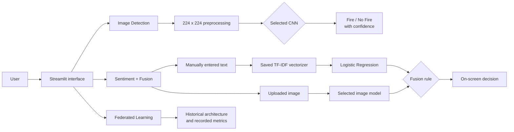
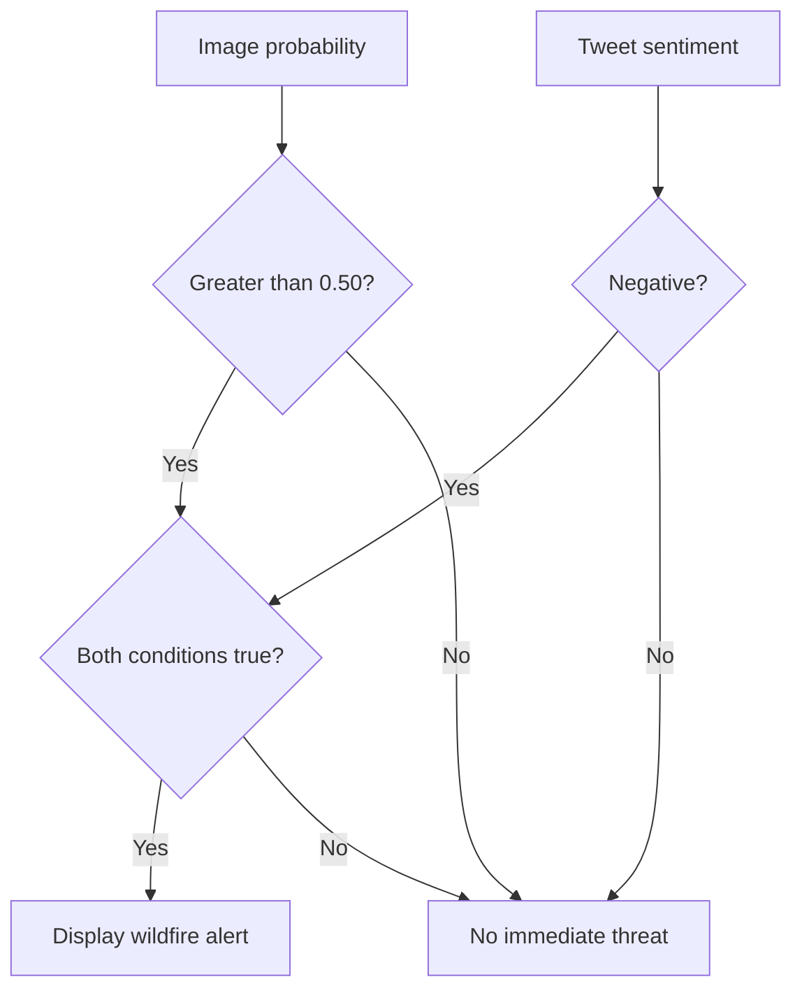
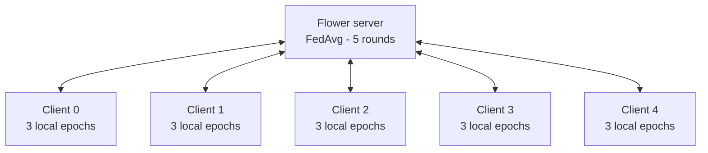

# Enhancing Wildfire Detection with Satellite Images and Social Media

> **Live Streamlit demo:** [Launch the application](https://ybesmanvdzs8u3rpqyhknj.streamlit.app/)

An experimental MSc Artificial Intelligence research prototype combining satellite-image classification, social-media text analysis, multimodal decision fusion, and federated-learning simulation for wildfire detection.

> [!IMPORTANT]
> This repository demonstrates research methods and model behaviour. It is **not** a production wildfire-warning system, emergency service, or substitute for official alerts. The public Streamlit application does not fetch live tweets, send emails, or perform federated training.

## Project overview

Wildfires threaten ecosystems, infrastructure, and human life, while satellite imagery can be difficult to classify when clouds, haze, sunlight, or red terrain resemble smoke and fire. The original MSc project investigated whether satellite-image evidence could be strengthened with contextual evidence from social-media text, while also exploring federated learning as a privacy-conscious training approach.

The research objectives were to:

1. Develop and compare four CNN-based models for binary wildfire image classification.
2. Build a Twitter sentiment pipeline using TF-IDF features and Logistic Regression.
3. Combine image and text predictions through a transparent fusion rule intended to reduce false alerts.
4. Simulate collaborative wildfire-image training with five Flower clients and Federated Averaging.

## Public demo versus original research

| Capability | Original MSc experiment | Public Streamlit demo |
|---|---|---|
| Image classification | Trained and evaluated four saved CNN models | Runs inference with those four local checkpoints |
| Social-media input | Research dataset was collected from Twitter/X | Accepts only text entered manually by the user |
| Fusion response | Demonstrated an email-alert workflow | Shows the decision and alert on screen only |
| Federated learning | Ran a Flower server with five training clients | Presents the recorded architecture and historical metrics only |
| Model training | Performed in research notebooks | No training or checkpoint modification |

The deployment package intentionally excludes the original notebooks, private datasets, API credentials, Gmail credentials, and SMTP code.

## Application tabs

### 1. Image Detection

Upload a JPG, JPEG, or PNG image, select a trained model, and receive a binary result with model confidence: **Fire Detected** or **No Fire Detected**.

The app preserves the preprocessing used by the research code: RGB conversion, resizing to `224 x 224`, pixel scaling by `1/255`, and a sigmoid decision threshold greater than `0.5` for the fire class.

### 2. Twitter Sentiment + Fusion

Enter tweet-style text manually and upload an image. The app applies the saved TF-IDF vectorizer and Logistic Regression classifier, runs the selected image model, and combines the outputs through the original rule.

- `0` - Negative / wildfire-related
- `1` - Positive / non-wildfire-related

### 3. Federated Learning

Explore a read-only explanation of the original Flower experiment, including the client/server topology, five-round training process, distributed validation loss, and per-client validation accuracy captured in notebook outputs. This tab does not start Flower services or perform live training.

## System architecture



## Image-classification models

| Model | Research approach | Deployment checkpoint |
|---|---|---|
| Custom CNN | Three convolution/pooling stages followed by dense classification layers | `wildfire_classification_model_cnn.h5` |
| MobileNetV2 | ImageNet transfer learning with a frozen convolutional base and custom sigmoid head | `wildfire_classification_model_model2.h5` |
| ResNet50 | ImageNet transfer learning with a frozen residual backbone and custom sigmoid head | `wildfire_classification_model_model3.h5` |
| Attention CNN | Custom CNN with channel-attention modules and global average pooling | `wildfire_classification_model_model4.h5` |

The dissertation selected ResNet50 for the original fusion experiment because its qualitative tests were more robust on noisy satellite scenes and red-coloured non-fire examples, despite its lower reported validation accuracy.

## Sentiment analysis

The original text pipeline assigned wildfire-related text to the Negative class and non-wildfire text to the Positive class. It used:

- TF-IDF unigram vectorisation
- English stop-word removal
- Maximum 5,000 features
- An 80/20 train/test split
- Logistic Regression for binary classification

The public app loads only the two trusted local artifacts supplied with this project: `vectorizer.pkl` and `sentiment_model.pkl`. Pickle files from unknown sources must not be substituted.

## Fusion decision logic

The original research rule triggers an alert only when both modalities indicate a potential wildfire:

```text
alert = (image_probability > 0.50) AND (sentiment_class == Negative)
```



| Image result | Sentiment | Fusion decision |
|---|---|---|
| Fire | Negative | Wildfire Alert |
| Fire | Positive | No Immediate Threat |
| No Fire | Negative | No Immediate Threat |
| No Fire | Positive | No Immediate Threat |

The demo displays this result on screen. It never sends email.

## Federated learning experiment

The MSc experiment used Flower to simulate collaborative training across five clients. Each client received global model parameters, trained the same two-class CNN locally for three epochs, and returned model updates to the central server. The server used `FedAvg` across five global rounds with all five clients participating.



| Verified setting | Value |
|---|---:|
| Flower clients | 5 |
| Global rounds | 5 |
| Local epochs per round | 3 |
| Aggregation | Federated Averaging (`FedAvg`) |
| Fit participation | `fraction_fit=1.0` |
| Minimum fit clients | 5 |
| Minimum available clients | 5 |

No raw client images were sent to the server in the experiment; clients exchanged model parameters. The public demo visualises the historical experiment and does not recreate this training session.

## Verified research results

### Image-model validation

These values come from the dissertation's consolidated result table and represent validation results, not production performance:

| Model | Validation accuracy | Validation loss |
|---|---:|---:|
| Custom CNN | 96.88% | 0.20 |
| MobileNetV2 | 99.53% | 0.02 |
| CNN with Attention | 95.38% | 0.11 |
| ResNet50 | 81.39% | 0.45 |

The report contains small inconsistencies between narrative sections and its consolidated table—for example, alternative Attention CNN and ResNet50 percentages appear elsewhere. This README uses the dissertation's final summary table rather than silently selecting the strongest figure.

### Independent image testing

The research also tested individual images sourced outside the training workflow and discussed outcomes qualitatively. These examples suggested that ResNet50 handled noisy scenes and red-coloured non-fire imagery more reliably than the other models. However, the dissertation does **not** report a separately labelled independent test set, sample count, or aggregate independent-test accuracy. These qualitative examples must therefore not be interpreted as a second benchmark.

### Sentiment evaluation

The detailed testing section reports 88.89% accuracy with precision `0.90`, recall `0.89`, and F1-score `0.88`. The dissertation's later summary table instead reports rounded accuracy of 89%, precision of 82%, and recall of 87%. Both are reproduced transparently because the source report does not reconcile the difference.

| Report location | Accuracy | Precision | Recall | F1-score |
|---|---:|---:|---:|---:|
| Detailed testing section | 88.89% | 0.90 | 0.89 | 0.88 |
| Consolidated summary table | 89% | 82% | 87% | Not reported |

These are research evaluation results on the project's labelled tweet dataset, not evidence of performance on live Twitter/X traffic.

### Federated-learning history

The recorded server history shows distributed validation loss decreasing from `129.03` in round 1 to approximately `0.63` in round 5. The dissertation's summary table reports a final global validation accuracy of 85% and loss of 0.63. Some per-client values in the dissertation summary differ from the raw notebook logs; the Streamlit visualisation therefore labels its notebook-derived curves explicitly as historical records rather than live or independently reproduced results.

## Technology stack

| Area | Technologies |
|---|---|
| Application | Python, Streamlit |
| Image modelling | TensorFlow, Keras, CNN, MobileNetV2, ResNet50, attention mechanism |
| Text modelling | scikit-learn, TF-IDF, Logistic Regression, Joblib |
| Federated learning | Flower, FedAvg |
| Data and visualisation | NumPy, pandas, Streamlit charts |
| Image handling | Pillow |
| Model storage | HDF5 (`.h5`) and trusted local Joblib/Pickle artifacts |

## Repository layout

```text
.
├── app.py
├── requirements.txt
├── README.md
├── .gitignore
├── .gitattributes
├── 4 cnn models/
│   ├── wildfire_classification_model_cnn.h5
│   ├── wildfire_classification_model_model2.h5
│   ├── wildfire_classification_model_model3.h5
│   └── wildfire_classification_model_model4.h5
└── fusion model/
    ├── sentiment_model.pkl
    └── vectorizer.pkl
```

All application paths are resolved relative to `app.py`, making the package portable between Windows and Linux.

## Local installation and usage

Python 3.12 is recommended.

```bash
git clone <repository-url>
cd <repository-folder>
python -m venv .venv
```

Activate the environment:

```bash
# Linux or macOS
source .venv/bin/activate

# Windows PowerShell
.\.venv\Scripts\Activate.ps1
```

Install and run:

```bash
python -m pip install --upgrade pip
python -m pip install -r requirements.txt
python -m streamlit run app.py
```

The HDF5 checkpoints are configured for Git LFS. Run `git lfs install` before cloning or committing model updates so the real model binaries—not pointer files—are available to TensorFlow.

## Limitations

- Validation metrics were produced in an MSc research setting and have not been independently reproduced for this public package.
- The report does not provide a quantitative external test-set benchmark.
- Satellite-scene artefacts such as cloud, haze, sunlight, smoke-like textures, and red terrain can produce false classifications.
- The text classifier is keyword-derived, binary, and limited in its handling of sarcasm, irony, mixed sentiment, multilingual text, and evolving vocabulary.
- The fixed fusion rule can suppress a genuine warning when only one modality indicates fire.
- The federated experiment used an evenly partitioned dataset; real clients would have heterogeneous, non-IID data and unreliable connectivity.
- Loading several TensorFlow models can consume substantial memory on constrained hosting platforms.
- The demo does not retrieve live satellite imagery or social-media posts and must not be used for emergency decisions.

## Future improvements

- Evaluate advanced CNNs and Vision Transformers on larger, geographically diverse datasets.
- Establish a documented, independently labelled external test set and report confidence intervals.
- Add temporal satellite analysis to track fire progression.
- Explore transformer-based text models for context, sarcasm, multilingual content, and location extraction.
- Calibrate model probabilities and replace the fixed fusion rule with a validated dynamic or learned fusion strategy.
- Evaluate federated learning on heterogeneous client datasets, client drop-out, secure aggregation, and differential privacy.
- Profile and optimise model size and memory before production-oriented cloud deployment.
- Integrate only verified official data feeds and emergency-service workflows after appropriate safety, governance, and operational review.

## Responsible use

This prototype is intended for education, portfolio review, and research demonstration. Its outputs are probabilistic model predictions and must be independently verified. For active wildfire information, follow official emergency-management and environmental-monitoring authorities.

## Author

**Mandhagini Madhavan**  
MSc Artificial Intelligence
